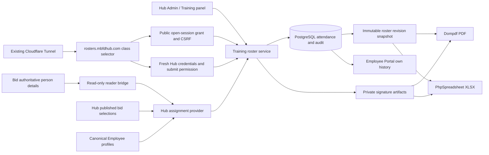

# MBFD Training Division digital rosters

Engineering design and implementation specification · October 15, 2026

## A. Recommendation and authorization

Extend the existing Hub modular application: Filament administration and Training panel, canonical Employee profiles, PostgreSQL, private file storage, Dompdf, and a dedicated React kiosk bundle. Add PhpSpreadsheet for genuine Excel files containing actual signatures. Do not create another personnel directory, authentication service, LMS, or Worker-hosted training database.

The original assignment authorized read-only discovery and a complete plan. Peter subsequently authorized autonomous implementation and explicitly directed completion through live deployment, including creation of the Cloudflare subdomain. Implementation, validation, additive production migration, immutable deployment and the scoped roster DNS/Tunnel/cache changes are authorized. Actual execution and acceptance evidence is recorded separately in the validation receipt.

The governing experience is simple: open `rosters.mbfdhub.com`, choose a course and open or start today's roster; members select their recent published-bid shift, rank and name, then sign. An authorized administrator enters fresh Hub credentials to submit the roster and close public sign-in. Staff review and download the completed roster privately. Submission approval and OIC handwritten certification are distinct records.

## B. Verified source findings and evidence boundaries

Audit baseline: Hub main `e5210909da407aa9514d285e8a0486ebcb5a4046`, obtained from GitHub on October 15. The original shared checkout was `feature/mbfd-coding-controller` at July commit `554958917da31595c3921636d21981dfc0ffc6ea`; its cached origin/main was September 23. Neither was used as the implementation baseline. A separate clone and branch `codex/training-roster` preserve existing worktrees. Bid bridge baseline: main `37af43bdd5c97a021a996723cec90781ca28d672` in a separate checkout.

| Area | Verified source and implication |
| --- | --- |
| Stack | `composer.lock`: Laravel 12.69.1, Filament 3.3.54, Livewire 3.8.7, Dompdf Laravel wrapper 3.1.2, Sanctum 4.3.1, Spatie Permission 6.24.1. Root Vite 8.0.16. Supplied Laravel 11/Vite 6 descriptions are outdated. |
| Admin | `app/Providers/Filament/AdminPanelProvider.php` assembles the navigation and existing authorization. New resources must use this panel rather than another admin application. |
| Training | `TrainingPanelProvider.php` already serves `/training`, discovers resources, applies canonical session middleware and training access. Preserve Training To-Do and its records. |
| To-Do | `app/Filament/Resources/TrainingTodoAdminResource.php` is the existing admin resource. Move its navigation group to Training; retain its policy, pages, data, attachments and notifications. |
| Personnel | `Employee.php` describes operational profiles, blocks model deletion and links to canonical User. `User.employee_profile_id` links to `employees.id`. User is the sole login principal; the historic employee guard is obsolete. |
| Employee history | `ResolvesCanonicalEmployee` delegates to `AuthenticatedMemberContextResolver`. Use this for own-history queries. `EmployeePanelProvider.php` explicitly registers pages. |
| Bid publication | `EmployeeBidAssignment`, `BidAssignmentReceiver`, and migration `2026_10_06_120000_create_employee_bid_assignments_table.php` preserve award revision/year/source/supersession. The user's explicit recent-bid instruction makes the official published result the sign-in shift authority. This identifies a bid selection without claiming an operational activation date. |
| Person details | Bid `apps/worker/src/lib/department-roster.ts` and `department-personnel.ts` resolve person rank/employment for an operational date and retain authoritative first/last names. Hub Employee profiles lack separate name parts. The read-only bridge supplies these details; operational shift placement does not override the published bid selection. |
| Signatures | `PersonnelRequests/SignatureImageService.php` already validates PNG, size, dimensions, nonblank ink, private writes and SHA256. Extend its allowed namespace narrowly rather than duplicate this logic. |
| Storage | `config/filesystems.php` offers private local storage and configured R2. This is configuration capability, not proof of the serving disk. |
| Host routing | `CanonicalHostRedirect.php` normally returns foreign hosts to the canonical Hub. A dedicated kiosk hostname needs its own explicit routes and isolation before session/auth handling. |
| Release | `hub-release-gates.yml`, `prepare-production-image.yml`, `deploy.yml`, production Dockerfile and image compose overlay define current immutable-image release. Old mutable server-pull procedures do not describe this baseline. |

Source inspection is not production proof. Subsequent authenticated preflight verified the GMKtec Hub runtime at `/opt/mbfd/mbfd-hub`, source `e5210909da407aa9514d285e8a0486ebcb5a4046`, immutable image digest `sha256:ed08be83659533c63092b4e2a1cc7b6cca90a4517a11b74ee40b8b3f85d048ac`, private local storage, and the existing remotely managed `mbfdhub-gmktec` Cloudflare tunnel. The roster hostname did not yet exist. Production role membership and effective assignment acceptance remain separate checks. Credentials are not included in source or this document.

The supplied PDF was structurally inspected and rendered: one US Letter portrait page, 612 × 792 points, rotation 0, no AcroForm fields or annotations. It has a department logo, underlined title, four-column classification block, yellow course-name line, sixteen numbered rows, last/first/date/signature columns, and final OIC name/ID/signature line. The supplied current logo replaces the older insignia without distortion.

## C. Application architecture

Both exports consume exactly one captured snapshot. Renderers do not reread mutable Employee or Bid data. Every attendance has a durable Employee foreign key plus attendance-time snapshots. A later bid or promotion never changes old rosters. Course definitions are reusable; sessions copy course name/classifications so editing a definition does not rewrite historical sessions.

Bid bridge: authenticated read-only `GET /api/portal/training-roster?as_of=YYYY-MM-DD`. It supplies authoritative person names, rank and employment evidence using the existing reader credential server-to-server. Hub joins those details to its validated published `EmployeeBidAssignment` revisions for shift and term, including retained nonbiddable assignments. Hub sets `TRAINING_ROSTER_BID_API_URL` explicitly to the verified Worker origin; no staging hostname heuristic. Invalid, stale, duplicate or unavailable evidence fails visibly; there is no manually maintained shift roster.

Training availability is distinct from permission to mutate Bid personnel. Bid's explicit inactive, retired and separated statuses are excluded. A member with Bid status `unknown` may be offered only when the same unique canonical Hub Employee is active and has a verified published bid assignment; the original `unknown` status remains in the attendance snapshot. The bridge never relabels unknown employment as active and does not change Bid lifecycle rules.

Preserve D Shift and Days where source distinguishes them. Person rank is distinct from the seat's applicable rank; Driver Engineer must not be invented as a rank when the source represents it as a qualification. The term label comes from the validated published bid result, not today's year. The shift-selection screen reminds members to use their recent selection for that term; the reminder is not included in roster views or exports. Attendance snapshots preserve the exact published row, result hashes and revision, with selection provenance rather than an invented effective date.

## D. Database and integrity design

Handwritten additive migration `2026_10_15_120000_create_training_roster_tables.php` creates six tables:

| Table | Key fields and relationships |
| --- | --- |
| `training_courses` | name, classifications JSON, description, default location, creator User, timestamps |
| `training_sessions` | unique public ULID, course FK, copied name/classifications, held_on, optional start/location/OIC Employee FK, status, revision, nullable creator, submission actor/time/UUID |
| `training_attendances` | session FK, Employee FK, historical snapshot JSON, private signature descriptor, original signed_at UTC, signature_signed_at UTC, voided_at, attendance submission UUID, request SHA256 |
| `training_roster_versions` | unique session/revision, immutable snapshot JSON, submission actor/time, separate certification actor/time/OIC snapshot/signature, immutable PDF/XLSX descriptors |
| `training_roster_audits` | session/attendance/actor references, event, complete prior/new values, reason, timestamp; nullable session for course events |
| `training_kiosk_grants` | session FK, SHA256 capability token, expiry, revocation, nullable creator; raw token never stored |

FKs restrict deletion of underlying evidence. Unique `(session, employee)` prevents duplicate attendance under concurrency; unique `(session, submission UUID)` binds retries to one request. Status/date and parent foreign-key indexes support listings and lookups. Employee history is indexed by its Employee FK. No hard-delete resource action is provided. Model guards prevent deletion of rosters, attendance, audit and versions; old evidence remains through voids/amendments. The migration down path deliberately refuses destruction; application rollback keeps additive tables.

Mutations lock the session row, validate allowed state and the submitted expected revision, apply one change, append audit and advance/capture a revision in one transaction. This serializes close/certify/sign/correct races. Audit captures original values and signature descriptors. Files are private and content-hashed; exports reject missing/tampered evidence. Filesystem and SQL are not a distributed transaction, so failed publication artifacts must be handled by bounded cleanup without deleting referenced originals.

State machine: staff-created draft → open; public start creates open directly. Open may become closed through staff management or submitted through fresh authorized credential approval. Closed or submitted may become certified with the authenticated OIC's own handwritten signature. Closed may reopen sign-in; submitted/certified may reopen to closed only with a reason. Closed/submitted/certified may archive. Submitted and archived submission versions retain the approver and timestamp; reopening preserves prior immutable versions while clearing the current submission approval. Submission is not OIC certification, and neither represents completion/CE/qualification. Completed and archived rosters remain private and downloadable by authorized staff.

Signature-only correction preserves original attendance timestamp and assignment snapshot. Replacing the employee requires a freshly collected signature and authoritative assignment on the original attendance date, with audit. `signature_signed_at` records the actual collection time of the current handwritten mark separately from original `signed_at`; corrected signatures must not appear backdated in documents. Instructor exceptions require an existing eligible canonical Employee, confirmed name parts, genuine signature and explanation; unknown assignment fields remain explicitly unverified, never fabricated.

An original request UUID remains associated with its recorded evidence even after correction. A delayed kiosk retry must not recreate a corrected-away identity. Receipts distinguish recorded, corrected, voided and unknown outcomes. A missing receipt after a transport failure is not proof the original write failed.

## E. Operational workflows

1. **Create/reuse course:** Training → Courses; search existing name; create only when absent; select original classifications and optional default location.
2. **Open/start publicly:** `rosters.mbfdhub.com` lists reusable courses and open sessions, with search and automatic refresh. Choose a dated open roster or Start today's roster. A course-row lock serializes anonymous starts: reuse the sole open session for that course on today's New York date, otherwise create a new open session; if multiple exist, require explicit session selection. Submitted or historical attendance is never reused. Anonymous creation records a null creator and a public-start audit event, not an invented staff identity. Staff can still create dated sessions in Training → Rosters.
3. **Sign:** public open roster → Sign Roster → shift from the latest applicable published bid → relevant person rank → alphabetical searchable name → verify selected identity → draw → Complete. A screen-only reminder distinguishes the recent bid from the previous bid. Success appears only after persisted receipt. Auto-return clears prior member and signature.
4. **Submit:** after everyone signs, select Submit roster and enter existing Hub email or employee ID and password. Fresh stateless verification requires current authentication eligibility, completed password setup, current admin entitlement and the explicit direct `training.rosters.submit` permission; active super_admin retains full access. The server rechecks current account/password/security version and permission under the submission transaction, requires the reviewed revision and at least one attendance, then captures the submitted version. The kiosk remains logged out, clears approval credentials, and returns to classes. Completed rosters disappear from the public catalog and cannot be reopened or read publicly.
5. **Correct/certify:** authorized staff reviews attendance and actual signatures privately. Corrections require a reason and fresh signature where needed; stale forms are rejected. Submitted/certified rosters require explicit reopen for corrections, preserving prior versions. OIC certification is a separate action requiring the acting account's own linked Employee and genuine handwritten signature.
6. **Download PDF / Excel:** visible staff actions on roster list and detail. Blank, open, partial, closed, submitted, certified, archived and historical versions export directly without a report builder. Each filename includes course/date/session/revision to prevent collisions. Submitted approval remains distinct from OIC evidence in both formats.
7. **Employee history:** existing Employee Portal → Training Division Classes Attended; own canonical profile only. Search/filter/date/status, including submitted and archived history. Attendance is not represented as course completion or credit. Voided entries must not count as valid attendance; corrections remain auditable to authorized staff.

## F. Administration design

Use existing local Plus Jakarta Sans, Hub navy palette, Filament components, consistent buttons and permissions. Training group contains Rosters, Courses and existing Training To-Do. Group dated sessions by course; show date, status, attendee count, instructor/OIC, and direct PDF/Excel actions. Search course titles; filter date/classification/status. This is a structured course/session interface rather than a general file manager.

Detail includes roster metadata, active/voided attendance, signature review, permitted corrections, lifecycle actions, preserved versions and audit events. Instructor exception controls remain secondary. Course creation/reuse and session opening should require only known operational facts; do not ask the instructor to reenter employee data.

Training viewer can read and export but cannot alter sessions or certify. Training admin and super_admin manage rosters. Existing Training To-Do authorization is preserved independently. OIC certification requires the acting account's canonical employee profile; an administrator cannot silently sign as someone else.

Public submission permission is managed through the existing audited Employees & Access → Access & capabilities → Edit direct administrative capabilities checkbox, “Training rosters — submit.” The effective status explains the separate admin-access requirement. The additive permission migration grants nobody this permission automatically. Existing protected access controls require the administrator's current password and a reason; ordinary role-inherited permissions cannot replace direct `admin.access` or direct `training.rosters.submit`. Super Administrator behavior follows the Hub's existing full-access rule.

## G. Kiosk design and recovery

The dedicated homepage shows current insignia, department/Training Division identity and the public searchable class selector. It loads actual course definitions and only open sessions; an empty catalog says no courses are available. It never invents a sample course. An open session shows course/date/location, count, attendance list, persistent green Sign Roster and a separate instructor Submit roster action.

Shift/rank choices derive from the verified feed. Name search is filtered to the selected shift/rank and alphabetized. Duplicate names use a minimal employee-number hint. The public list shows name/rank/shift/signed indicator, never signature PNGs, full employee numbers or export links. Controls are at least 48–56px, with larger classroom selections; viewport-specific layouts keep the main action reachable. Long attendance tables scroll independently.

The signature canvas uses Pointer Events for finger/stylus/mouse, fixed bounded bitmap dimensions, Clear/Back/Complete, and server-side nonblank validation. Canvas drawing does not scroll the page; other areas remain scrollable. Keyboard users can navigate choices and request instructor assistance for handwriting. Respect reduced-motion preferences and visible focus.

Public open/start uses CSRF-protected POST to obtain a session-scoped, expiring device grant without creating a staff identity. The legacy instructor-issued fragment link remains supported; its fragment is removed before normal navigation and exchanged through CSRF-protected POST. Grants bind operations to a session and support expiry/revocation; they do not make open classroom attendance private from public visitors. The kiosk uses its own host-only HttpOnly SameSite cookie; Hub admin cookies are not reused. Unknown kiosk-host routes—including admin/general API/login—fail closed. Fresh submission credentials are checked with the existing canonical resolver and Laravel provider, generic denial and identity/IP throttling, without login, remember cookie or persistent admin session.

Refresh the course/open-session catalog every 15 seconds while visible and when visibility returns. Poll the small open roster while visible/idle and refresh immediately after own save, without full-page reloads or a new realtime service. A lost attendance response triggers receipt lookup; retry uses the same UUID/body. Store only its receipt identifier and timestamp in tab storage; handwriting remains in memory until confirmed or deliberately resolved. For uncertain roster approval, retain the submission UUID, reviewed revision and minimal course/date/count summary in tab storage so reload can recover the same request; never store credentials, attendee lists or signatures there. Recovery requires fresh credentials from the same approver, and receipt recovery does not expose completed attendance. Offline signing is not falsely presented as saved. A future offline queue requires a separately designed shared-device data lifecycle.

## H. PDF specification

US Letter portrait, source-faithful organization, proportionate current logo, MBFD Training Roster heading, course/date/classifications, numbered Last Name/First Name/Date/Signature rows, and OIC printed name/employee ID/actual signature. Use all sixteen original categories: Task Level/Company; Officer Training; ICS / NIMS / FFOG; Driver Training; Special Ops; RIT/MD/Survival; Hazmat Training; Extrication; Marine Training; Water Rescue; Fire Boat Operation; Night Drill; SIMM Training; EMS Training; Pre-Fire/Prevention; Equipment Inservice.

Target sixteen attendance slots per page with explicit page partitioning; zero attendees yields a printable blank roster. Repeat branding/course/table headings and page X of Y. Continue numbering, never split a row/signature, preserve proportions, bound long titles/names without clipping. Display the current handwritten signature's collection timestamp separately from original attendance date where they differ. Submission approval and any OIC certification are displayed from the captured version; submitted alone must not claim OIC certification. The implementation must render representative pages and inspect margins, typography, OIC block and signature placement; a PDF parser or HTTP 200 alone does not establish fidelity.

Original signatures persist independently of documents. Hash-verified PNG bytes enter the renderer; no cursive font substitution, remote logo fetch, or arbitrary HTML/image URL. Document status, version and capture time identify the exact attendance snapshot.

## I. Excel specification

Genuine OpenXML `.xlsx`, generated by PhpSpreadsheet, with two worksheets:

- **Printable roster:** branding, course/session/classifications/status, attendance cells plus embedded handwritten signature images, OIC evidence, explicit row heights/widths, repeatable page blocks and Letter print setup.
- **Attendance data:** one actual spreadsheet row per valid attendee; sequence, first/last name, person rank, shift, string employee ID, attendance date and original signed time, current signature collection timestamp, attendance status, signature confirmation, course/session/revision metadata. Freeze headings and enable filter/sort. Do not put movable signature drawings in the sortable data sheet.

Text fields are explicit string cells so leading-zero identifiers and formula-like user text remain literal. Numeric sequence/counts and date/time cells use deliberate types and formats. Image count and placement must match the snapshot; no truncation at sixteen rows. Print sheets keep signatures aligned; structured data remains useful for imports without pretending drawings sort reliably with rows. Excel and a common alternate viewer must be visually reviewed when available. Automated XML/drawing checks supplement that inspection.

PhpSpreadsheet was selected over a larger Laravel Excel abstraction because the immediate requirement is controlled formatted workbooks with drawings, not an import/export job framework. Official recipes document Drawing/MemoryDrawing and explicit string cell types: https://phpspreadsheet.readthedocs.io/en/stable/topics/recipes/ and https://phpspreadsheet.readthedocs.io/en/stable/topics/accessing-cells/ .

## J. Security and evidence boundaries

| Actor | Allowed | Denied |
| --- | --- | --- |
| Public visitor | Course/open-session catalog; start/reuse today's roster or open a listed session through CSRF-protected POST | Completed/private roster reads, signatures, exports, course editing, approval without fresh authorized credentials |
| Open-session kiosk | Open roster read, filtered candidates, handwritten attendance and receipt recovery within its session grant | Completed attendance reads, corrections, certification, exports, staff account session |
| Freshly verified submitter | Submit reviewed revision with current admin entitlement and direct submit permission, or active super_admin; recover own submission UUID | Reuse of stored credentials, OIC certification by credential approval alone, public completed-roster access |
| Training viewer | Authorized roster/version/signature review and exports | Writes and certification |
| Training admin / super_admin | Audited management, supervised exception, OIC self-certification, preserved downloads | Silent evidence replacement, hard deletion, signing as another OIC |
| Employee | Own history through canonical resolver | Other employee history and administrative roster exports |

Every protected download checks policy and parent/session identity; possession of an object path is not authorization. CSRF protects browser writes. Grant exchange and submission have rate limits. Private/no-store and no-referrer headers protect session data; kiosk is not indexed or framed. Application checks remain required behind Cloudflare. Never log raw tokens, signature data URLs, cookies or credential files.

A handwritten mark at a shared unauthenticated kiosk is supervised attendance evidence, not cryptographic identity proof. Public course/open-session discovery is intentional. Controls are session-scoped device grants, visible identity confirmation, validated actual signatures, fresh authorized approval to complete a roster, exception audit and separate OIC review. Individual member login is intentionally not required to sign attendance; credentials are required to approve roster submission.

## K. Cloudflare and hosting plan

Preferred: existing Cloudflare zone/Tunnel → current protected Hub origin → dedicated hostname route and bundle → existing DB/private storage. A separate Worker frontend or database adds credentials, cross-origin/session complexity and duplicate deployments without a demonstrated need. The Bid bridge is a read-only extension of the existing Bid Worker, not a new training service.

Before any future change, read actual zone records, Tunnel identity/config/ingress ordering, origin Nginx server names, Access apps/policies, TLS and Cache Rules. Determine whether the tunnel is remotely or locally managed. Preserve exact current objects and config hashes. Add only roster hostname → verified origin service; do not replace catch-all ingress or alter existing hosts. Add origin host allowlist entry if required. Set `TRAINING_ROSTER_HOST`, scheme and exact Bid API origin; preserve Hub `APP_URL` and canonical authentication.

Use explicit cache bypass for roster HTML/JSON and all private downloads; immutable compiled assets may retain normal asset caching. Verify no `CF-Cache-Status: HIT` for sensitive responses, no cached Set-Cookie, and host-only cookies in real browser. Do not place mandatory per-firefighter Access login on sign-in. Keep management, review and export routes on canonical authenticated Hub; the kiosk's fresh-credential submission endpoint grants no admin session. Block unrelated routes on the kiosk host. Verify TLS, forwarded host/proto trust, direct-origin protection and API authorization independently. Cloudflare documents that a published hostname maps to a local Tunnel service: https://developers.cloudflare.com/tunnel/concepts/routing/ . DNS creation alone does not prove Access, Nginx, application routing or cache behavior.

Rollback only the added hostname/ingress/cache rule and application image/config, preserving all recorded data and original private files. No Cloudflare resources were provisioned by this implementation.

## L. File-level implementation and sequence

| Phase | Main components | Dependency / acceptance |
| --- | --- | --- |
| 1 Discovery | Current refs, panels, identity, bid projection, workflows, supplied PDF | Exact-source evidence and explicit unknowns |
| 2 Domain | `Models/Training/Training{Course,Session,Attendance,KioskGrant}.php`, roster audit/version models; additive migration; `Services/Training/TrainingRosterService.php` | DB invariants, historical snapshots, rollback retention, PostgreSQL races |
| 3 Published bid identity | `TrainingAssignmentProvider.php`, existing `EmployeeBidAssignment`; read-only Bid person-details bridge and tests | Correct published term, supersession/provenance, retained assignments, D/Days/person rank, unavailable evidence fails closed |
| 4 Admin | Filament Training course/session resources/pages; TrainingRosterPolicy; panel registration; existing To-Do group change | Role-specific real create/open/correct/certify/archive/download workflow |
| 5 Kiosk | `routes/training-roster.php`; host/private-response middleware; kiosk service/controllers; `TrainingRosterSubmissionAuthenticator.php`; explicit submit permission; React `resources/js/training-roster`; Blade shell and launch page | Public class refresh/start/reuse, completed-record privacy, stateless fresh approval, cross-session denial, CSRF, touch workflow, retry/privacy/responsive tests |
| 6 Documents | `TrainingRosterExportService.php`, PDF Blade template, approved logo, PhpSpreadsheet lock | Actual PDF/XLSX, signatures, versions, visual rendering, count matrix |
| 7 Employee | `TrainingHistoryPage.php`, employee Blade history and registration | Canonical own-history, void/correction behavior, no cross-employee access |
| 8 Integration QA | PHPUnit, PostgreSQL, browser config/spec, build/typecheck, security checks | Exact evidence and no regression of existing panels/bid/identity |
| 9 Release readiness | Existing required CI/image gates or explicit local equivalents; isolated restore and migration | No test/security failure waived; candidate source bound to artifacts |
| 10 Activation | Read-only infrastructure preflight, authorized immutable image deploy, hostname change | Runtime identity, signed-in operator acceptance; physical touchscreen and print acceptance by the operator |

After shared domain contracts, admin, kiosk and export work can proceed in parallel with nonoverlapping file ownership. Merge/rebase only after preserving other work and reconciling exact current main; do not reset dirty shared checkouts. Recheck source drift before release and repeat only affected checks.

## M. QA and Actions fallback adaptation

The two supplied fallback attachments are byte-identical. Their central rule is retained: local evidence is LOCAL; substantive failures are not waived. Current evidence corrected the assumed outage: main e5210909 had successful CI run 38644057159, image preparation 38644057226 and deployment workflow 38650008030 on October 14. These run results do not prove serving runtime. A separate October 15 candidate's dependency audit executed and failed on two Symfony advisories; this is not a billing failure. Inspect the exact future candidate's run/job reason before selecting fallback.

Preserve the existing workflows. Map the actual `hub-release-gates.yml` lanes: CI configuration; changed PHP lint/Pint and Composer validation; PHPStan; actionlint; PostgreSQL 16.13 unit/integration/concurrency; browser/Daily integrity; generated assets; Composer/NPM audit, Gitleaks and Trivy; PHP 8.5 compatibility; existing AI gateway safety checks. Root build/typecheck must include the kiosk. Add kiosk browser contract tests to existing browser lane. Provider-specific check contexts and approval/publishing evidence remain NOT LOCALLY VERIFIED when unavailable; do not invent run IDs or hosted attestations. The inspected Hub image pipeline does not declare a hosted attestation step, so do not impose a different repository's attestation procedure.

Isolated local validation uses the candidate checkout, its lockfiles and test-only databases/storage/ports. Never load the supplied production credential file into test environment. Native PHP 8.5 and Node 22 evidence is labeled accordingly; Linux image/runtime compatibility is separate. Use task-local PHP configuration for required extensions, not global runtime changes. Record candidate commit/tree, command, environment/version, start/end/exit, status and evidence location for each gate. Partial output or an unfinished process is not PASS.

Required feature matrix:

- Courses/sessions: public catalog refresh and open-only listing, course-lock start/reuse today, ambiguous multiple-open selection, null anonymous creator, repeated and same-day sessions, search/filter, valid and invalid state transitions, stale-form conflict, draft/open/closed/submitted/certified/archived exports.
- Assignments: published bid selection differs from older operational shift, applicable term and publication history, midnight New York boundary, superseded/source revisions, retained/nonbiddable assignments, D/Days, person versus seat rank, promotion/transfer, inactive/missing employees, duplicate names/IDs, stale/unavailable feed and explicit exceptions.
- Kiosk: public entry and scoped grant, wrong session, expired/revoked grant, completed-roster denial, CSRF, invalid/blank/oversized PNG, duplicate UUID/body mismatch, duplicate employee, simultaneous sign/submit/close, unknown attendance or approval outcome, reload recovery with the same UUID and fresh credentials, corrected/voided receipt, credential clearing/no persistent login, reset/privacy, 150-row sticky action.
- Administration: direct submit grant plus current admin access; role-only/member/disabled/departed/forced-password-change denial; generic credential errors and throttling; audited permission grant/revoke; viewer cannot mutate; unauthorized direct HTTP/Livewire denied; OIC self-sign only; actual signature timestamp review; reason required for correction/reopen; submitted/archived approval and old signed snapshots/document bytes retained.
- PDF counts: 0,1,16,17,32,33,50,100 plus long metadata; page counts, all names, proportionate signatures, categories/OIC, branding, no overlap, actual render inspection.
- Excel: real ZIP/OpenXML, every row/signature drawing, string IDs including leading zeros, formula injection literals, filters/freeze/print areas, long lists, both worksheets and viewer inspection.
- Cross-format: same session/revision/count/identities/status/OIC; no independent live queries; hash mismatch fails; concurrent export preserves one artifact identity.
- Employee: canonical resolution, history survives bid/profile changes, correction/void handling, no cross-employee scope, mobile presentation.
- Regression: existing Admin/Training To-Do/Employee navigation, canonical login/session/authorization, Bid publication/read contracts, operational forms, signature service default namespace and generated assets.

Browser fixture tests explicitly prove browser behavior against the documented API contract; PHPUnit proves real HTTP/persistence boundaries. Neither is labeled an authenticated production end-to-end test. Real deployment acceptance must additionally exercise the actual bridge, origin, canonical staff login, two simultaneous sessions, real PDF/XLSX opening, and human touchscreen/stylus/printing observation.

## N. Release risks and rollback

Main risks: stale baseline, confusing published/effective bids, source shift normalization, shared-domain cookies, anonymous impersonation, lost-save retries, stale staff edits, mutable signature paths, large-image workbook memory, and changing evidence after certification. Exact source, canonical IDs, versioned bridge validation, host isolation, supervision, idempotency, revision checks, hash verification, bounded images and preserved snapshots address these directly.

Future release must capture consistent PostgreSQL dump plus required private files/config, prove isolated restore, apply migration on that copy, verify old image can run with additive schema, and retain tested rollback image digest. Do not restore an old DB over newly collected attendance as a routine rollback. Disable new kiosk ingress/sign-in first if activation fails; preserve submissions, signatures, exports, audit and backup. Validate immutable image digest, OCI source label, embedded SHA/assets, schema, health/restarts, routing and authenticated workflows after activation. Existing deploy workflow dump-list/hash validation is not itself restore rehearsal.

Retain official evidence indefinitely until the department defines an authorized retention schedule. Do not invent a deletion policy or imply legal certification. Storage growth from version snapshots and signed exports should be monitored using ordinary existing observability, without a new service.

## O. Optional enhancements

Defer bulk ZIP/date-range export, QR generation, PDF inline preview, and realtime push until individual downloads and supervised kiosk use are accepted. Direct session links and accurate counts are first-release basics. Avoid certificate/CE tracking, automated qualification updates, attendance scoring, general-purpose document management and separate user accounts.

## P. Readiness verdict

The existing ecosystem supplies identity, panels, policies, private storage, signature validation and PDF rendering. The implementation adds normalized training records, immutable revisions, admin/history workflows, a public course/open-roster kiosk, stateless authorized submission, published-bid identity integration and genuine dual-format export. It reuses existing authentication and personnel authorities without creating another operational database.

Activation still requires current infrastructure/role/assignment readback, exact-candidate validation, successful isolated restore/migration checks, verification of the separately deployed Bid bridge, and the authorized hostname/image changes. Actual public-entry and fresh-approval acceptance follows activation; human touchscreen/print acceptance remains an operator check. No invented credentials, effective dates, live records or production results substitute for these gates. See the accompanying validation receipt for checks actually executed and their results; this specification describes intended behavior and acceptance, not proof that every gate has passed.
