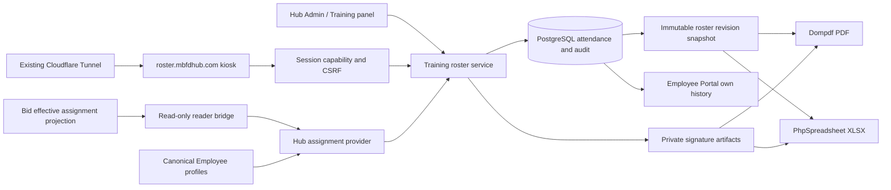

# MBFD Training Division digital rosters

Engineering design and implementation specification · October 15, 2026

## A. Recommendation and authorization

Extend the existing Hub modular application: Filament administration and Training panel, canonical Employee profiles, PostgreSQL, private file storage, Dompdf, and a dedicated React kiosk bundle. Add PhpSpreadsheet for genuine Excel files containing actual signatures. Do not create another personnel directory, authentication service, LMS, or Worker-hosted training database.

The original assignment authorized read-only discovery and a complete plan. Peter subsequently authorized autonomous implementation once the design was ready. Source implementation and isolated validation are therefore authorized. Production deployment, DNS/Tunnel changes, live data migration, and real attendance collection have not been performed under this work.

The governing experience is simple: instructor opens a session; member selects current shift, rank and name, then signs; staff download PDF or Excel directly. The engineering absorbs identity, effective dates, concurrency, evidence retention and retries.

## B. Verified source findings and evidence boundaries

Audit baseline: Hub main `e5210909da407aa9514d285e8a0486ebcb5a4046`, obtained from GitHub on October 15. The original shared checkout was `feature/mbfd-coding-controller` at July commit `554958917da31595c3921636d21981dfc0ffc6ea`; its cached origin/main was September 23. Neither was used as the implementation baseline. A separate clone and branch `codex/training-roster` preserve existing worktrees. Bid bridge baseline: main `37af43bdd5c97a021a996723cec90781ca28d672` in a separate checkout.

| Area | Verified source and implication |
| --- | --- |
| Stack | `composer.lock`: Laravel 12.69.1, Filament 3.3.54, Livewire 3.8.7, Dompdf Laravel wrapper 3.1.2, Sanctum 4.3.1, Spatie Permission 6.24.1. Root Vite 8.0.16. Supplied Laravel 11/Vite 6 descriptions are outdated. |
| Admin | `app/Providers/Filament/AdminPanelProvider.php` assembles the navigation and existing authorization. New resources must use this panel rather than another admin application. |
| Training | `TrainingPanelProvider.php` already serves `/training`, discovers resources, applies canonical session middleware and training access. Preserve Training To-Do and its records. |
| To-Do | `app/Filament/Resources/TrainingTodoAdminResource.php` is the existing admin resource. Move its navigation group to Training; retain its policy, pages, data, attachments and notifications. |
| Personnel | `Employee.php` describes operational profiles, blocks model deletion and links to canonical User. `User.employee_profile_id` links to `employees.id`. User is the sole login principal; the historic employee guard is obsolete. |
| Employee history | `ResolvesCanonicalEmployee` delegates to `AuthenticatedMemberContextResolver`. Use this for own-history queries. `EmployeePanelProvider.php` explicitly registers pages. |
| Bid publication | `EmployeeBidAssignment`, `BidAssignmentReceiver`, and migration `2026_10_06_120000_create_employee_bid_assignments_table.php` preserve award revision/year/source/supersession. They do not store effective dates. Latest published award cannot establish today's assignment. |
| Effective roster | Bid `apps/worker/src/lib/department-roster.ts` and `department-personnel.ts` resolve assignments/rank/employment for an operational date. Planned future awards must not appear before effective date. Existing admin API uses human admin JWT; the existing reader bridge lacked a current-roster endpoint. |
| Signatures | `PersonnelRequests/SignatureImageService.php` already validates PNG, size, dimensions, nonblank ink, private writes and SHA256. Extend its allowed namespace narrowly rather than duplicate this logic. |
| Storage | `config/filesystems.php` offers private local storage and configured R2. This is configuration capability, not proof of the serving disk. |
| Host routing | `CanonicalHostRedirect.php` normally returns foreign hosts to the canonical Hub. A dedicated kiosk hostname needs its own explicit routes and isolation before session/auth handling. |
| Release | `hub-release-gates.yml`, `prepare-production-image.yml`, `deploy.yml`, production Dockerfile and image compose overlay define current immutable-image release. Old mutable server-pull procedures do not describe this baseline. |

Source inspection is not production proof. No live Cloudflare zone/DNS/Tunnel/Access/cache export, serving image identity, production role membership, current employee counts, actual bid effective dates or private-disk readback was obtained. Before activation these require authenticated read-only preflight, retaining a redacted receipt. Credentials are not included in source or this document.

The supplied PDF was structurally inspected and rendered: one US Letter portrait page, 612 × 792 points, rotation 0, no AcroForm fields or annotations. It has a department logo, underlined title, four-column classification block, yellow course-name line, sixteen numbered rows, last/first/date/signature columns, and final OIC name/ID/signature line. The supplied current logo replaces the older insignia without distortion.

## C. Application architecture

Both exports consume exactly one captured snapshot. Renderers do not reread mutable Employee or Bid data. Every attendance has a durable Employee foreign key plus attendance-time snapshots. A later bid or promotion never changes old rosters. Course definitions are reusable; sessions copy course name/classifications so editing a definition does not rewrite historical sessions.

Bid bridge: authenticated read-only `GET /api/portal/training-roster?as_of=YYYY-MM-DD`. It reuses the effective operational projection, returns only required names/personnel identifiers/rank/shift/assignment provenance, and uses the existing reader credential server-to-server. Hub sets `TRAINING_ROSTER_BID_API_URL` explicitly to the verified Worker origin; no staging hostname heuristic. Invalid, stale, duplicate or unavailable source fails visibly. There is no fallback to latest award or a manually maintained shift roster.

Preserve D Shift and Days where source distinguishes them. Person rank is distinct from the seat's applicable rank; Driver Engineer must not be invented as a rank when the source represents it as a qualification. A term label is shown only when established by source metadata. Otherwise the truthful label is “Current assignment.” The interface cannot manufacture a 2026–2027 effective term from today's year.

## D. Database and integrity design

Handwritten additive migration `2026_10_15_120000_create_training_roster_tables.php` creates six tables:

| Table | Key fields and relationships |
| --- | --- |
| `training_courses` | name, classifications JSON, description, default location, creator User, timestamps |
| `training_sessions` | unique public ULID, course FK, copied name/classifications, held_on, optional start/location/OIC Employee FK, status, revision, creator |
| `training_attendances` | session FK, Employee FK, historical snapshot JSON, private signature descriptor, signed_at UTC, voided_at, submission UUID, request SHA256 |
| `training_roster_versions` | unique session/revision, immutable snapshot JSON, certification actor/time/OIC snapshot/signature, immutable PDF/XLSX descriptors |
| `training_roster_audits` | session/attendance/actor references, event, complete prior/new values, reason, timestamp; nullable session for course events |
| `training_kiosk_grants` | session FK, SHA256 capability token, expiry, revocation, creator; raw token never stored |

FKs restrict deletion of underlying evidence. Unique `(session, employee)` prevents duplicate attendance under concurrency; unique `(session, submission UUID)` binds retries to one request. Status/date and parent foreign-key indexes support listings and lookups. Employee history is indexed by its Employee FK. No hard-delete resource action is provided. Model guards prevent deletion of rosters, attendance, audit and versions; old evidence remains through voids/amendments. The migration down path deliberately refuses destruction; application rollback keeps additive tables.

Mutations lock the session row, validate allowed state and the submitted expected revision, apply one change, append audit and advance/capture a revision in one transaction. This serializes close/certify/sign/correct races. Audit captures original values and signature descriptors. Files are private and content-hashed; exports reject missing/tampered evidence. Filesystem and SQL are not a distributed transaction, so failed publication artifacts must be handled by bounded cleanup without deleting referenced originals.

State machine: draft → open → closed → certified; closed may reopen sign-in; certified may reopen to closed only with a reason; closed/certified may archive. Archived records remain downloadable and immutable. Certification is roster attestation, not completion/CE/qualification.

Signature-only correction preserves original attendance timestamp and assignment snapshot. Replacing the employee requires a freshly collected signature and authoritative assignment on the original attendance date, with audit. Instructor exceptions require an existing eligible canonical Employee, confirmed name parts, genuine signature and explanation; unknown assignment fields remain explicitly unverified, never fabricated.

An original request UUID remains associated with its recorded evidence even after correction. A delayed kiosk retry must not recreate a corrected-away identity. Receipts distinguish recorded, corrected, voided and unknown outcomes. A missing receipt after a transport failure is not proof the original write failed.

## E. Operational workflows

1. **Create/reuse course:** Training → Courses; search existing name; create only when absent; select original classifications and optional default location.
2. **Open session:** Training → Rosters; select course/date and optional start/location/OIC. Multiple same-day sessions are distinguished by public session ID and start. Open sign-in; obtain the classroom link.
3. **Sign:** open authorized session link → Sign Roster → current shift → relevant rank → alphabetical searchable name → verify selected identity → draw → Complete. Success appears only after persisted receipt. Auto-return clears prior member and signature.
4. **Correct:** authorized staff opens attendance row, inspects actual signature, supplies reason and corrected identity/fresh signature where needed. Stale forms are rejected. Void preserves original evidence. Certified sessions require explicit reopen first.
5. **Certify:** close sign-in, review attendance/download provisional exports, resolve exceptions, capture the authenticated OIC's own signature and certify. Preserve snapshot and all earlier revisions.
6. **Download PDF / Excel:** visible actions on roster list and detail. Blank, open, partial, closed, certified, archived and historical versions all export directly without a report builder. Each filename includes course/date/session/revision to prevent collisions.
7. **Employee history:** existing Employee Portal → Training Division Classes Attended; own canonical profile only. Search/filter/date/status. Attendance is not represented as course completion or credit. Voided entries must not count as valid attendance; corrections remain auditable to authorized staff.

## F. Administration design

Use existing local Plus Jakarta Sans, Hub navy palette, Filament components, consistent buttons and permissions. Training group contains Rosters, Courses and existing Training To-Do. Group dated sessions by course; show date, status, attendee count, instructor/OIC, and direct PDF/Excel actions. Search course titles; filter date/classification/status. This is a structured course/session interface rather than a general file manager.

Detail includes roster metadata, active/voided attendance, signature review, permitted corrections, lifecycle actions, preserved versions and audit events. Instructor exception controls remain secondary. Course creation/reuse and session opening should require only known operational facts; do not ask the instructor to reenter employee data.

Training viewer can read and export but cannot alter sessions or certify. Training admin and super_admin manage rosters. Existing Training To-Do authorization is preserved independently. OIC certification requires the acting account's canonical employee profile; an administrator cannot silently sign as someone else.

## G. Kiosk design and recovery

Dedicated bundle and page show current insignia, department/Training Division identity, course/date/location, count, attendance list and persistent green Sign Roster. No session means a clean blank state; never show a sample course in production.

Shift/rank choices derive from the verified feed. Name search is filtered to the selected shift/rank and alphabetized. Duplicate names use a minimal employee-number hint. The public list shows name/rank/shift/signed indicator, never signature PNGs, full employee numbers or export links. Controls are at least 48–56px, with larger classroom selections; viewport-specific layouts keep the main action reachable. Long attendance tables scroll independently.

The signature canvas uses Pointer Events for finger/stylus/mouse, fixed bounded bitmap dimensions, Clear/Back/Complete, and server-side nonblank validation. Canvas drawing does not scroll the page; other areas remain scrollable. Keyboard users can navigate choices and request instructor assistance for handwriting. Respect reduced-motion preferences and visible focus.

The session capability is in a URL fragment, removed before normal navigation and exchanged through CSRF-protected POST. Hash-only storage, expiry, explicit revocation and per-request session checks constrain access. The kiosk uses its own host-only HttpOnly SameSite cookie; Hub admin cookies are not reused. Unknown kiosk-host routes—including admin/API/login—fail closed. Do not set a broad cross-subdomain session cookie for this feature.

Poll the small public roster every 15 seconds only while visible/idle, and refresh immediately after own save. This avoids a new realtime service and limits operational complexity. No full-page refresh polling. A lost response triggers receipt lookup; retry uses the same UUID/body. Keep only the pending receipt identifier in tab storage, not a persistent handwriting/personnel cache. Handwriting remains in memory until confirmed or deliberately resolved. Offline signing is not falsely presented as saved; the interface explains recovery and instructor assistance. A future offline queue would require a separately designed shared-device data lifecycle.

## H. PDF specification

US Letter portrait, source-faithful organization, proportionate current logo, MBFD Training Roster heading, course/date/classifications, numbered Last Name/First Name/Date/Signature rows, and OIC printed name/employee ID/actual signature. Use all sixteen original categories: Task Level/Company; Officer Training; ICS / NIMS / FFOG; Driver Training; Special Ops; RIT/MD/Survival; Hazmat Training; Extrication; Marine Training; Water Rescue; Fire Boat Operation; Night Drill; SIMM Training; EMS Training; Pre-Fire/Prevention; Equipment Inservice.

Target sixteen attendance slots per page with explicit page partitioning; zero attendees yields a printable blank roster. Repeat branding/course/table headings and page X of Y. Continue numbering, never split a row/signature, preserve proportions, bound long titles/names without clipping. Certification is displayed from the captured version; provisional exports say uncertified. The implementation must render representative pages and inspect margins, typography, OIC block and signature placement; a PDF parser or HTTP 200 alone does not establish fidelity.

Original signatures persist independently of documents. Hash-verified PNG bytes enter the renderer; no cursive font substitution, remote logo fetch, or arbitrary HTML/image URL. Document status, version and capture time identify the exact attendance snapshot.

## I. Excel specification

Genuine OpenXML `.xlsx`, generated by PhpSpreadsheet, with two worksheets:

- **Printable roster:** branding, course/session/classifications/status, attendance cells plus embedded handwritten signature images, OIC evidence, explicit row heights/widths, repeatable page blocks and Letter print setup.
- **Attendance data:** one actual spreadsheet row per valid attendee; sequence, first/last name, person rank, shift, string employee ID, attendance date and signed time, attendance status, signature confirmation, course/session/revision metadata. Freeze headings and enable filter/sort. Do not put movable signature drawings in the sortable data sheet.

Text fields are explicit string cells so leading-zero identifiers and formula-like user text remain literal. Numeric sequence/counts and date/time cells use deliberate types and formats. Image count and placement must match the snapshot; no truncation at sixteen rows. Print sheets keep signatures aligned; structured data remains useful for imports without pretending drawings sort reliably with rows. Excel and a common alternate viewer must be visually reviewed when available. Automated XML/drawing checks supplement that inspection.

PhpSpreadsheet was selected over a larger Laravel Excel abstraction because the immediate requirement is controlled formatted workbooks with drawings, not an import/export job framework. Official recipes document Drawing/MemoryDrawing and explicit string cell types: https://phpspreadsheet.readthedocs.io/en/stable/topics/recipes/ and https://phpspreadsheet.readthedocs.io/en/stable/topics/accessing-cells/ .

## J. Security and evidence boundaries

| Actor | Allowed | Denied |
| --- | --- | --- |
| Unpaired visitor | Blank landing | Directory, attendance, signatures, mutations, exports |
| Authorized session kiosk | Current session read, filtered candidates, new handwritten attendance, own submission receipt | Course/session administration, other sessions, corrections, certification, exports |
| Training viewer | Authorized roster/version/signature review and exports | Writes and certification |
| Training admin / super_admin | Audited management, supervised exception, OIC self-certification, preserved downloads | Silent evidence replacement, hard deletion, signing as another OIC |
| Employee | Own history through canonical resolver | Other employee history and administrative roster exports |

Every protected download checks policy and parent/session identity; possession of an object path is not authorization. CSRF protects browser writes. Grant exchange and submission have rate limits. Private/no-store and no-referrer headers protect session data; kiosk is not indexed or framed. Application checks remain required behind Cloudflare. Never log raw tokens, signature data URLs, cookies or credential files.

A handwritten mark at a shared unauthenticated kiosk is supervised attendance evidence, not cryptographic identity proof. Low-friction control is instructor-controlled session/device access, short-lived links, visible identity confirmation, no unsigned administrator edits, exception audit, and OIC review. Individual member login is intentionally not required.

## K. Cloudflare and hosting plan

Preferred: existing Cloudflare zone/Tunnel → current protected Hub origin → dedicated hostname route and bundle → existing DB/private storage. A separate Worker frontend or database adds credentials, cross-origin/session complexity and duplicate deployments without a demonstrated need. The Bid bridge is a read-only extension of the existing Bid Worker, not a new training service.

Before any future change, read actual zone records, Tunnel identity/config/ingress ordering, origin Nginx server names, Access apps/policies, TLS and Cache Rules. Determine whether the tunnel is remotely or locally managed. Preserve exact current objects and config hashes. Add only roster hostname → verified origin service; do not replace catch-all ingress or alter existing hosts. Add origin host allowlist entry if required. Set `TRAINING_ROSTER_HOST`, scheme and exact Bid API origin; preserve Hub `APP_URL` and canonical authentication.

Use explicit cache bypass for roster HTML/JSON and all private downloads; immutable compiled assets may retain normal asset caching. Verify no `CF-Cache-Status: HIT` for sensitive responses, no cached Set-Cookie, and host-only cookies in real browser. Do not place mandatory per-firefighter Access login on sign-in. Keep instructor/admin routes on canonical authenticated Hub and block unrelated routes on kiosk host. Verify TLS, forwarded host/proto trust, direct-origin protection and API authorization independently. Cloudflare documents that a published hostname maps to a local Tunnel service: https://developers.cloudflare.com/tunnel/concepts/routing/ . DNS creation alone does not prove Access, Nginx, application routing or cache behavior.

Rollback only the added hostname/ingress/cache rule and application image/config, preserving all recorded data and original private files. No Cloudflare resources were provisioned by this implementation.

## L. File-level implementation and sequence

| Phase | Main components | Dependency / acceptance |
| --- | --- | --- |
| 1 Discovery | Current refs, panels, identity, bid projection, workflows, supplied PDF | Exact-source evidence and explicit unknowns |
| 2 Domain | `Models/Training/Training{Course,Session,Attendance,KioskGrant}.php`, roster audit/version models; additive migration; `Services/Training/TrainingRosterService.php` | DB invariants, historical snapshots, rollback retention, PostgreSQL races |
| 3 Effective identity | `TrainingAssignmentProvider.php`; isolated Bid `/api/portal/training-roster` bridge and tests | Future awards excluded, D/Days/person rank correct, unavailable feed fails closed |
| 4 Admin | Filament Training course/session resources/pages; TrainingRosterPolicy; panel registration; existing To-Do group change | Role-specific real create/open/correct/certify/archive/download workflow |
| 5 Kiosk | `routes/training-roster.php`; host/private-response middleware; kiosk service/controllers; React `resources/js/training-roster`; Blade shell and launch page | Cross-session denial, CSRF, touch workflow, retry/privacy/responsive tests |
| 6 Documents | `TrainingRosterExportService.php`, PDF Blade template, approved logo, PhpSpreadsheet lock | Actual PDF/XLSX, signatures, versions, visual rendering, count matrix |
| 7 Employee | `TrainingHistoryPage.php`, employee Blade history and registration | Canonical own-history, void/correction behavior, no cross-employee access |
| 8 Integration QA | PHPUnit, PostgreSQL, browser config/spec, build/typecheck, security checks | Exact evidence and no regression of existing panels/bid/identity |
| 9 Release readiness | Existing required CI/image gates or explicit local equivalents; isolated restore and migration | No test/security failure waived; candidate source bound to artifacts |
| 10 Future activation | Read-only infrastructure preflight, authorized immutable image deploy, hostname change | Runtime identity, signed-in operator acceptance, physical touchscreen and print acceptance |

After shared domain contracts, admin, kiosk and export work can proceed in parallel with nonoverlapping file ownership. Merge/rebase only after preserving other work and reconciling exact current main; do not reset dirty shared checkouts. Recheck source drift before release and repeat only affected checks.

## M. QA and Actions fallback adaptation

The two supplied fallback attachments are byte-identical. Their central rule is retained: local evidence is LOCAL; substantive failures are not waived. Current evidence corrected the assumed outage: main e5210909 had successful CI run 38644057159, image preparation 38644057226 and deployment workflow 38650008030 on October 14. These run results do not prove serving runtime. A separate October 15 candidate's dependency audit executed and failed on two Symfony advisories; this is not a billing failure. Inspect the exact future candidate's run/job reason before selecting fallback.

Preserve the existing workflows. Map the actual `hub-release-gates.yml` lanes: CI configuration; changed PHP lint/Pint and Composer validation; PHPStan; actionlint; PostgreSQL 16.13 unit/integration/concurrency; browser/Daily integrity; generated assets; Composer/NPM audit, Gitleaks and Trivy; PHP 8.5 compatibility; existing AI gateway safety checks. Root build/typecheck must include the kiosk. Add kiosk browser contract tests to existing browser lane. Provider-specific check contexts and approval/publishing evidence remain NOT LOCALLY VERIFIED when unavailable; do not invent run IDs or hosted attestations. The inspected Hub image pipeline does not declare a hosted attestation step, so do not impose a different repository's attestation procedure.

Isolated local validation uses the candidate checkout, its lockfiles and test-only databases/storage/ports. Never load the supplied production credential file into test environment. Native PHP 8.5 and Node 22 evidence is labeled accordingly; Linux image/runtime compatibility is separate. Use task-local PHP configuration for required extensions, not global runtime changes. Record candidate commit/tree, command, environment/version, start/end/exit, status and evidence location for each gate. Partial output or an unfinished process is not PASS.

Required feature matrix:

- Courses/sessions: repeated and same-day sessions, search/filter, valid and invalid state transitions, stale-form conflict, draft/open/closed/certified/archived exports.
- Assignments: future award before effective date, midnight New York boundary, source revisions, retained/nonbiddable assignments, D/Days, person versus seat rank, promotion/transfer, inactive/missing employees, duplicate names/IDs, stale/unavailable feed and explicit exceptions.
- Kiosk: no pairing, wrong session, expired/revoked grant, CSRF, invalid/blank/oversized PNG, duplicate UUID/body mismatch, duplicate employee, simultaneous submit/close, unknown save outcome, recovered receipt, corrected/voided receipt, reset/privacy, 150-row sticky action.
- Administration: viewer cannot mutate; unauthorized direct HTTP/Livewire denied; OIC self-sign only; actual signature review; reason required for correction/reopen; old signed snapshots and document bytes retained.
- PDF counts: 0,1,16,17,32,33,50,100 plus long metadata; page counts, all names, proportionate signatures, categories/OIC, branding, no overlap, actual render inspection.
- Excel: real ZIP/OpenXML, every row/signature drawing, string IDs including leading zeros, formula injection literals, filters/freeze/print areas, long lists, both worksheets and viewer inspection.
- Cross-format: same session/revision/count/identities/status/OIC; no independent live queries; hash mismatch fails; concurrent export preserves one artifact identity.
- Employee: canonical resolution, history survives bid/profile changes, correction/void handling, no cross-employee scope, mobile presentation.
- Regression: existing Admin/Training To-Do/Employee navigation, canonical login/session/authorization, Bid publication/read contracts, operational forms, signature service default namespace and generated assets.

Browser fixture tests explicitly prove browser behavior against the documented API contract; PHPUnit proves real HTTP/persistence boundaries. Neither is labeled an authenticated production end-to-end test. Real deployment acceptance must additionally exercise the actual bridge, origin, canonical staff login, two simultaneous sessions, real PDF/XLSX opening, and human touchscreen/stylus/printing observation.

## N. Release risks and rollback

Main risks: stale baseline, confusing published/effective bids, source shift normalization, shared-domain cookies, anonymous impersonation, lost-save retries, stale staff edits, mutable signature paths, large-image workbook memory, and changing evidence after certification. Exact source, canonical IDs, versioned bridge validation, host isolation, supervision, idempotency, revision checks, hash verification, bounded images and preserved snapshots address these directly.

Future release must capture consistent PostgreSQL dump plus required private files/config, prove isolated restore, apply migration on that copy, verify old image can run with additive schema, and retain tested rollback image digest. Do not restore an old DB over newly collected attendance as a routine rollback. Disable new kiosk ingress/sign-in first if activation fails; preserve submissions, signatures, exports, audit and backup. Validate immutable image digest, OCI source label, embedded SHA/assets, schema, health/restarts, routing and authenticated workflows after activation. Existing deploy workflow dump-list/hash validation is not itself restore rehearsal.

Retain official evidence indefinitely until the department defines an authorized retention schedule. Do not invent a deletion policy or imply legal certification. Storage growth from version snapshots and signed exports should be monitored using ordinary existing observability, without a new service.

## O. Optional enhancements

Defer bulk ZIP/date-range export, QR generation, PDF inline preview, and realtime push until individual downloads and supervised kiosk use are accepted. Direct session links and accurate counts are first-release basics. Avoid certificate/CE tracking, automated qualification updates, attendance scoring, general-purpose document management and separate user accounts.

## P. Readiness verdict

The existing ecosystem supplies identity, panels, policies, private storage, signature validation and PDF rendering. The implementation adds normalized training records, immutable revisions, admin/history workflows, controlled kiosk access, current-assignment bridge, and genuine dual-format export. A source implementation is feasible without changing authentication or creating another operational database.

Activation still requires current infrastructure/role/assignment readback, exact-candidate validation, successful isolated restore/migration checks, Bid bridge deployment before enabling automatic candidate selection, explicit deployment scope, and human touchscreen/print acceptance. No invented credentials, effective dates, live records or production results substitute for these gates. See the accompanying validation receipt for checks actually executed and their results; this specification describes intended behavior and acceptance, not proof that every gate has passed.
